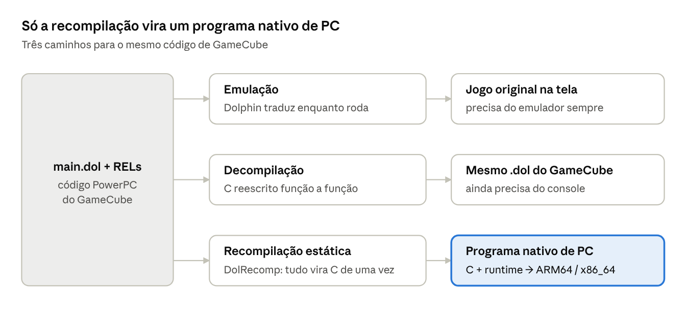

# Roteiro de vídeo: recompilando Auto Modellista para PC

23/10/2026 · Guilherme · Espelho de [Roteiro de vídeo (doc)](https://claude.ai/artifact/6nuBK9gyqKM3wP5tHJhBpL)

## Ficha do vídeo

Vídeo horizontal de bastidores, em primeira pessoa, contando como um jogo de GameCube está virando um programa nativo de PC com ajuda de IA.

| Item | Valor |
| --- | --- |
| Formato | Talking head + b-roll (gameplay no Dolphin, telas de terminal, diagramas) |
| Duração estimada | 15–20 min no vídeo completo; um Short de 60–90 s com o gancho e o “main alcançado” |
| Tom | Didático e honesto: mostra o que deu certo e o que deu errado |
| Público | Quem curte jogos antigos e tecnologia, sem exigir saber programar |
| Cuidados | Não mostrar código do jogo nem bytes da ISO; gameplay do Dolphin em trechos curtos; citar que o decomp.wtf foi descontinuado e o motivo |

**Como este roteiro é atualizado:** a cada marco ou descoberta relevante do projeto, entra uma cena nova no capítulo certo e uma linha no registro do fim. Cada cena tem **Fala** (o que você diz), **Na tela** (o que mostrar, descrito para gravar ou montar) e **Motion** (sugestão de animação ou transição para aquele momento).

## Gancho (0:00–0:45)

**Fala:** “Esse é Auto Modellista, um jogo de corrida da Capcom de 2002, com cara de desenho animado. Ele nunca saiu pra PC. A pergunta é: dá pra pegar o código de GameCube e transformar num programa que roda nativo no computador, sem emulador? Spoiler: essa semana o jogo ligou pela primeira vez fora do console. Sem imagem ainda, mas ligou. E quem fez boa parte do trabalho foi IA.”

**Na tela:**

- Abertura do jogo rodando no Dolphin (o mosaico de carros amarelo).
- Corte seco para o terminal: `[OSReport] Dolphin OS … Console Type : Development HW3` e `M4: main alcançado`.
- Texto na tela: “GameCube → C → PC”.

**Motion:**

- 0:00–0:08: abertura em tela cheia com zoom lento (Ken Burns) no mosaico de carros, música de fundo baixa.
- No “sem emulador?”: a imagem racha em blocos de pixel e cai, revelando o terminal preto (transição “glitch” curta, 6 frames).
- As linhas do `OSReport` aparecem digitando, uma por vez; `main alcançado` acende em verde com um “pulse”.
- Card de título: “GameCube → C → PC”, cada palavra entra da esquerda com seta desenhando entre elas.

## Cap. 1 — O jogo e o ponto de partida

**Fala:** “Eu já vinha brincando com o decomp.wtf, uma ferramenta que põe agentes de IA para reescrever as funções de um jogo em C, uma por uma, até o compilador original gerar exatamente os mesmos bytes. Chegamos a 3% do jogo. Só que tem dois problemas. Primeiro: mesmo com 100% decompilado, o resultado ainda é um jogo de GameCube. Segundo: o autor descontinuou a ferramenta, porque a comunidade de decompilação é contra fazer isso com IA. Então eu precisava de outro caminho.”

**Na tela:**

- Painel do decomp.wtf: “3,04% of code · 933 / 3.903 functions”.
- Print da página de descontinuação do decomp.wtf, com o trecho sobre a comunidade.
- Gráfico simples: 3% hoje → 100% “muito tempo”.

**Motion:**

- Gravação de tela do painel do decomp.wtf com zoom no contador “3,04%” e um círculo desenhando em volta.
- Barra de progresso animada: enche até 3% e trava; um texto “100% = muito tempo” aparece no fim da barra vazia.
- Print da página de descontinuação em moldura no canto, com a frase sobre a comunidade sublinhada por um marca-texto animado.
- Card do jogo (capa + “Auto Modellista · Capcom · 2002”) no canto superior durante o capítulo.

## Cap. 2 — Como funciona: três jeitos de levar um jogo para o PC

**Fala:** “Existem três jeitos de fazer um jogo de console rodar no PC. O primeiro você conhece: emulador. O Dolphin finge ser um GameCube e traduz o código enquanto o jogo roda. Funciona muito bem, mas o jogo continua sendo de GameCube. O segundo é a decompilação: reescrever o jogo em C até bater byte a byte com o original. Ótimo pra entender e modificar, mas o resultado volta a ser um arquivo de GameCube. O terceiro é o que estamos fazendo: recompilação estática. Uma ferramenta pega todo o código PowerPC do jogo e traduz pra C de uma vez só, antes de rodar. Aí eu compilo esse C pro meu processador. Só que esse código ainda acha que está num GameCube, então eu preciso escrever um ‘GameCube falso’ em C, a runtime, que responde no lugar do hardware.”

**Na tela:**

- Este diagrama, animado caminho por caminho; o terceiro acende por último.
- Analogia visual: emulação = intérprete ao vivo; recompilação = livro traduzido inteiro antes de ler.
- Detalhe para quem gosta: o PowerPC guarda os números “de trás pra frente” em relação ao PC (big-endian), e a runtime cuida disso em um lugar só.

**Motion:**

- O diagrama monta em três tempos, sincronizado com a fala: caixa “main.dol + RELs” surge; a cada caminho citado, a seta desenha da esquerda para a direita e as duas caixas da linha entram com fade + leve subida.
- Emulação e decompilação ficam acinzentadas depois de explicadas; na recompilação, a caixa final acende em azul com brilho suave.
- Analogia: split screen; à esquerda um balão de intérprete traduzindo frase a frase em tempo real; à direita um livro inteiro sendo “impresso” de uma vez (páginas folheando rápido).
- Big-endian: os bytes `12 34 56 78` em quatro blocos que giram e trocam de ordem para `78 56 34 12`, com rótulos “GameCube” e “PC”.

## Cap. 3 — As ferramentas e como funcionam

Uma cena por ferramenta. Ghidra e REA entraram em uso de verdade no M5, para achar o caminho pelos menus até a corrida.

### 3.1 DolRecomp: o tradutor

**Fala:** “O DolRecomp lê o executável do GameCube, o `main.dol`, e os 12 módulos extras, os RELs. Cada instrução PowerPC vira uma linha de C. Foram 341 mil instruções no DOL e 255 mil nos RELs, nenhuma desconhecida. Deu 84 MB de C que ninguém vai ler, mas o compilador lê em 30 segundos.”

**Na tela:** uma instrução PowerPC ao lado da linha de C equivalente (exemplo genérico, não código do jogo); contador “0 instruções desconhecidas”.

**Motion:** a instrução PowerPC fica à esquerda; uma seta “DolRecomp” varre a tela e a linha de C aparece à direita. Depois, um “chuva” rápida de linhas de C borradas (para não mostrar código do jogo) com o contador subindo até “341.000 + 255.000 instruções” e o selo “0 desconhecidas” batendo como carimbo.

### 3.2 A runtime: o GameCube falso

**Fala:** “O C gerado acha que está num GameCube. Quando ele escreve num endereço que no console seria o chip de vídeo, alguém precisa responder. Esse alguém é a runtime, que eu estou escrevendo em C puro, com uma única biblioteca, a SDL3, pra janela, som e controle. E tem uma regra: se aparecer algo que a runtime não conhece, o programa para e diz exatamente o quê. Nada de emulador escondido.”

**Na tela:** a mensagem `[FATAL] bus: leitura de 4 byte(s) em 0xCC002000 (VI)` como exemplo de “parar e dizer o quê”; diagrama de camadas: C gerado → runtime → SDL3 → sistema.

**Motion:** pilha de camadas montando de baixo para cima (Sistema → SDL3 → runtime → C gerado), cada uma deslizando no lugar. Uma “bolinha” de pedido desce da camada do jogo até a runtime e volta com a resposta. Na mensagem `[FATAL]`, a tela dá um tremor curto e o endereço `0xCC002000 (VI)` ganha destaque em vermelho.

### 3.3 Dolphin como gabarito

**Fala:** “E como eu sei que está certo, se ainda nem tem imagem? Uso o Dolphin como gabarito. Eu rodo o jogo original no Dolphin com milhares de pontos de parada e anoto cada função que ele chama. A minha versão anota a mesma coisa. Um script compara as duas listas. Até a função `main`, foram 1.998 eventos idênticos.”

**Na tela:** dois terminais lado a lado (Dolphin x runtime) rolando a lista; o veredito `IGUAIS: 1998 eventos normalizados idênticos; os dois terminam em main: True`.

**Motion:** dois terminais lado a lado rolando em sincronia, com linhas iguais piscando em verde nos dois lados ao mesmo tempo. Um contador central sobe até 1.998. No fim, um “=” grande aparece entre os terminais e o veredito `IGUAIS` entra em destaque.

### 3.4 Ghidra: o raio-X do jogo

**Fala:** “Até o boot eu não precisei entender o jogo, só traduzir. No M5 isso mudou: sem apertar botão, o jogo para na tela de ‘Sem Memory Card, começar sem salvar?’, e o módulo da corrida, o `game.rel`, só é carregado quando uma corrida começa. Eu precisava saber quais telas existem e que botão leva de uma à outra. Pra isso entra o Ghidra, a ferramenta de engenharia reversa da NSA. Ele lê o código de máquina e mostra o assembly, um pseudocódigo parecido com C e quem chama quem. E com a extensão do Gekko ele entende até as instruções especiais do processador do GameCube.”

**Na tela:**

- A tela do jogo no Dolphin parada em “No Memory Card… start without saving?” (print curto).
- O Ghidra aberto no `main.elf`: lista de funções (3.897), um painel de assembly e um de pseudocódigo, com o código borrado e só nomes e endereços visíveis.
- O perfil `PowerPC:BE:32:Gekko_Broadway` na barra de status.

**Motion:** zoom guiado na gravação do Ghidra: lista de funções → clique numa função → assembly e pseudocódigo lado a lado, com um realce percorrendo a linha correspondente nos dois. Código borrado, nomes nítidos. A tela do jogo parada entra antes como “o problema”, com um cadeado desenhado sobre o botão de corrida.

### 3.5 REA: a IA dentro do Ghidra

**Fala:** “Só que eu não fiquei clicando no Ghidra. Quem clicou foi a IA, através do REA, um conector que deixa o modelo usar o Ghidra sozinho. Eu pedi pro agente achar onde o jogo carrega a corrida. Ele procurou os textos dos menus, seguiu quem chama quem e leu o pseudocódigo. Voltou com evidência: a função que, logo no começo, deixa todos os módulos pré-carregados na memória de áudio do GameCube; a função que liga cada módulo; e seis funções de troca de módulo, com a corrida sempre no espaço 1 e o menu no espaço 2. E de brinde achou um erro nas minhas anotações: uma função que eu achava que trocava a imagem da tela era outra, e o endereço certo estava logo ao lado.”

**Na tela:**

- O fluxo: pergunta → agente → REA → Ghidra → resposta com evidência.
- O resultado real do REA ao abrir o jogo: `procedure_count: 3897`, `string_count: 9905`, linguagem `Gekko_Broadway`.
- Um diagrama dos módulos: `game`, `menu`, `menu00`, `menu01`, `vj` e 7 `msg_*` entrando na ARAM; depois `menu.rel` no espaço 2 e `game.rel` no espaço 1.
- A correção: `VISetNextFrameBuffer` riscado no endereço errado e o certo ao lado (só nomes e endereços).
- O caminho pelos menus, achado no Dolphin com capturas da tela (a lógica dos menus mora nos módulos de menu, que o decomp não cobre): “No Memory Card” → Yes; logos e filme (START pula); PRESS START; menu principal com “arcade”; “single race”; seleção de pista (Suzuka).
- O resto até a largada, também no Dolphin: um A a cada 300 quadros, do 3300 ao 5700 (pista, música, carro, estilo, ajuste, regras, “go race”). A captura do quadro 7600 mostra a corrida andando (Viper em 8º, volta 1/3). Marco: o `OSLink` do `game.rel` no quadro 5731.

**Motion:** quatro caixas (Você → IA → REA → Ghidra) com um pacote de luz indo e voltando; na volta, a resposta abre como cartão com três campos: “função”, “evidência”, “incerto”. Depois, os módulos voam como cartuchos para dentro de uma caixa “ARAM”, e dois encaixes rotulados “espaço 1: corrida” e “espaço 2: menu” recebem `game.rel` e `menu.rel`. Na correção, um carimbo “errado” no nome antigo e uma seta curta até o endereço certo.

### 3.6 Instalando Ghidra e REA: dois tropeços (gravado em 23/10)

**Fala:** “Instalar não foi só ‘next, next’. Primeiro: o Ghidra oficial não vem com o decompilador nativo pra Mac com chip Apple, só pra Linux e Windows. Tive que compilar essa peça, levou 36 segundos. Segundo: o REA recusou o arquivo do jogo, porque ele vinha marcado como ‘PowerPC embarcado’, uma variante diferente. Essa marcação é só um rótulo no cabeçalho, então fiz uma cópia sem ela. Aí funcionou: o Ghidra achou 3.897 funções e quase 10 mil textos dentro do jogo. E ainda tem um porém: o Ghidra não conhece as instruções especiais do processador do GameCube, o Gekko. Pra isso existe uma extensão da comunidade que ensina o Gekko pro Ghidra. Instalei, e as instruções de matemática vetorial do GameCube passaram a ser lidas.”

**Na tela:**

- A pasta do Ghidra mostrando só `linux_x86_64` e `win_x86_64` em `Decompiler/os/`; depois o `BUILD SUCCESSFUL in 36s` e o arquivo `mac_arm_64/decompile`.
- A mensagem do REA: “EF_PPC_EMB declares an embedded PowerPC variant”.
- O byte do cabeçalho mudando de `0x80000000` para `0x00000000`.
- O resultado: `procedure_count = 3897`, `string_count = 9902`.
- Depois: a extensão GameCubeLoader na pasta de extensões e o perfil `PowerPC:BE:32:Gekko_Broadway` no resultado do REA.

**Motion:** a pasta do Ghidra abre e as duas plataformas aparecem; um espaço vazio pisca com “mac_arm_64?” e depois é preenchido com uma engrenagem girando (compilando) e um check. Para o rótulo: o cabeçalho do arquivo como uma etiqueta de bagagem com “EMB” carimbado; uma tesoura corta o carimbo e o arquivo passa pela catraca do REA. Contadores sobem até 3.897 e 9.902.

## Cap. 4 — Bastidores: como a IA trabalhou

### 4.1 Um time de IAs, cada uma no seu tamanho

**Fala:** “Eu não usei uma IA só. Pensei como num time. O Opus, o modelo mais forte, ficou com as partes em que é preciso pensar e investigar: o boot do jogo e o sistema operacional do GameCube. O Sonnet ficou com o trabalho grande mas bem especificado: montar o esqueleto, a build, os testes. E o Haiku, o mais rápido e barato, é o candidato pro trabalho repetitivo que tem um corretor automático, tipo casar funções no decomp, onde a ferramenta diz na hora se acertou.”

**Na tela:** três cartões (Opus, Sonnet, Haiku), cada um com as tarefas que pegou; abaixo, a lista de commits do projeto (`git log --oneline`) com os marcos M3, M4 e M5.

**Motion:** os três cartões entram como cartas sendo distribuídas na mesa; cada tarefa citada voa do centro para o cartão certo. Os commits sobem como uma timeline vertical, um por vez, com o nome do marco acendendo.

### 4.2 M3: o jogo inteiro num executável só

**Fala:** “Primeiro passo: juntar os 84 MB de C do jogo e dos módulos num programa só. 155 pedaços, nenhum conflito. O programa ainda não faz nada, mas ele existe, roda no Mac M4 e no modo x86_64 via Rosetta, que é o processador de PC.”

**Na tela:** terminal com `C gerado: ligado; 155 trecho(s) no dispatcher` e `M3: esqueleto OK`; o comando `file` mostrando “arm64” e depois “x86_64”.

**Motion:** 155 blocos pequenos caindo como Tetris e encaixando num retângulo único com o nome `automodellista`; depois o retângulo “vira” (flip) mostrando o selo arm64 de um lado e x86_64 do outro.

### 4.3 M4: o jogo liga

**Fala:** “Aí veio o momento mais legal até agora. O código do próprio jogo, traduzido, inicializou o sistema do GameCube e imprimiu a mensagem que só aparecia em kit de desenvolvimento: Dolphin OS, Console Type: Development HW3, Memory 24 MB. E chegou na função `main` fazendo exatamente as mesmas chamadas que o jogo original no Dolphin.”

**Na tela:** o log completo do `OSReport` até `M4: main alcançado`; em seguida o comparador com `IGUAIS: 1998 eventos`.

**Motion:** o log digita linha a linha com som de teclado sutil; “Console Type : Development HW3” ganha zoom e um rótulo explicativo (“kit de desenvolvimento da Nintendo”); no `main alcançado`, confete discreto ou um “ding” visual.

### 4.4 O dia em que o disco encheu

**Fala:** “E nem tudo deu certo. Na primeira vez que a IA rodou o boot, o programa entrou num loop infinito e ficou escrevendo um log sem parar. Foram 20 GB, o disco do Mac lotou e até a própria IA travou, porque não conseguia nem rodar comando. A causa era um detalhe: o tradutor deixa para a runtime avançar o contador de programa depois de certas instruções, e a runtime não fazia isso. Então ele executava a mesma instrução pra sempre. Lição: tudo pesado foi pro SSD externo, o log ganhou limite de tamanho e o programa ganhou um ‘cão de guarda’ que mata o loop.”

**Na tela:** o `df -h` com 1,4 GB livres; o arquivo `runtime_trace.txt` de 20,7 GB; depois o `df -h` com 21 GB livres e a pasta no SSD.

**Motion:** um medidor de disco enchendo do verde ao vermelho em acelerado, com o tamanho do arquivo subindo em contador; a tela “trava” por meio segundo (freeze frame com ruído). Depois o arquivo é arrastado para uma lixeira e o medidor despenca. Para explicar o bug: uma seta de “pc” presa batendo na mesma instrução em loop, e então um “+4” empurrando a seta para a próxima linha.

### 4.5 M5: do disco à largada

**Fala:** “No M5 o jogo passou do boot. Ele começou a ler arquivos do disco e carregar os módulos de menu, pedindo exatamente os mesmos arquivos, na mesma ordem e nos mesmos lugares do disco que o jogo original no Dolphin. Mas a corrida mora num módulo separado, que só é carregado quando você aperta “go race”. E sem tela, como apertar botão? Eu escrevi um roteiro de botões: em tal quadro, aperta A. O mesmo roteiro vai pro Dolphin, por um controle virtual, e pra runtime. Atravessa o aviso do memory card, a abertura, o PRESS START, o menu, a pista, o carro… e larga. No começo os dois se desencontravam no menu, porque a runtime lia o disco numa velocidade inventada. Copiei o modelo de drive do Dolphin, com busca, rotação e buffer, e aí o módulo da corrida passou a carregar no mesmo quadro nos dois lados: 5.731. Teve ainda um detalhe curioso: o Dolphin usava o relógio do meu Mac e a runtime começava no ano 2000, e só isso fazia as telas de carregamento lerem arquivos diferentes. Relógio fixo, leituras iguais. De quebra apareceu um bug de verdade: o menu e a corrida usam o mesmo endereço, um depois do outro, e a runtime confundia os dois. Resultado: 6.400 quadros, a corrida carregada, e 669 quadros depois disso sem erro, no Mac M e em x86.”

**Na tela:**

- O roteiro de botões como uma linha do tempo de quadros (D\_LEFT, A, START, START, A, A… “go race”).
- As capturas do Dolphin pelo caminho, de “No Memory Card” até a corrida andando.
- A saída real do `verify_m5.sh`: `OSLink do módulo 1 no quadro 5731, 669 quadros depois -> OK` nos dois lados, `ESTRITO IGUAL: 103 eventos`, `FLUXO IGUAL: 441 leituras de 10 arquivo(s) ADX`, `eventos de módulo: 12; quadros iguais nos dois lados: True`, `== OK`.
- O antes e o depois do tempo de disco: evento 71 no quadro 2092 (Dolphin) contra 2053 (runtime), depois os dois no mesmo quadro.
- Os tempos: 6.400 quadros em 57 s no arm64 e 81 s no x86\_64 (Rosetta), contra 128 s no Dolphin com o depurador ligado.

**Motion:** uma régua de quadros corre na base da tela; nos pontos do roteiro, um botão do controle acende (A, START) e a captura correspondente sobe como um cartão. Em 5.731, o cartão “game.rel” encaixa num slot “espaço 1” com um clique, nos dois lados ao mesmo tempo. No trecho do tempo de disco, dois marcadores de quadro desalinhados deslizam até se juntar. No relógio, um calendário “2000” e um “2026” se trocam até ficarem iguais. Fecha com os dois `OK` acendendo lado a lado.

### 4.6 O dia em que o SSD sumiu

**Fala:** “Depois do disco cheio, eu mudei tudo que é pesado pra um SSD externo, dentro de uma imagem de disco. Resolveu um problema e criou outro. No meio do M5, com uma hora e quarenta e seis minutos de trabalho da IA, o macOS simplesmente desmontou essa imagem. A pasta do projeto sumiu de baixo dos pés do agente, e ele morreu no meio de uma investigação. Quase tudo sobreviveu: o trabalho não commitado continuava dentro da imagem, só uma edição pequena se perdeu. Eu montei de novo e retomei… e uma hora depois aconteceu de novo. Dessa vez nem eu, a IA principal, conseguia rodar comando, porque até a pasta temporária do Claude Code morava no SSD. A causa provável era boba: o Mac põe o disco pra dormir depois de dez minutos parado, e um SSD de USB que dorme pode ser desconectado. Desliguei o repouso do disco, tirei a pasta temporária do SSD e virou regra: antes de rodar algo longo, conferir se o volume está lá. Só que meia hora depois caiu uma terceira vez, com o repouso já desligado. Então não era isso, ou não era só isso: a suspeita agora é a ligação USB do SSD, o cabo, a porta ou a energia. O agente do M5 terminou ali, parado na tela de escolher a pista. Reiniciei o Mac, montei de novo e uma sessão nova retomou do ponto exato, porque tudo estava escrito: o commit, a página de status e um arquivo de retomada. E pra não depender mais de mim montando o disco: um script no disco interno, que um agendador do macOS roda a cada minuto. Se o SSD some e volta, as imagens montam sozinhas. O log do kernel confirmou o culpado: “media is not present”, o próprio aparelho USB saindo do ar.”

**Na tela:**

- O Finder ou terminal sem `/Volumes/AMRecomp` (pasta ausente).
- O comando `hdiutil attach /Volumes/SSD/AMRecomp.sparsebundle` e a pasta voltando.
- O `git status` com os arquivos ainda não commitados intactos (`ax_voice.c`, `os_threads.c`…).
- A segunda queda: a sessão respondendo `EACCES: permission denied, mkdir '/Volumes/AMRecomp'` a qualquer comando.
- O `pmset -g` com `disksleep 10` e depois `disksleep 0`.
- A terceira queda (\~18:05), já com `disksleep 0`: a hipótese do repouso de disco riscada e “cabo / porta / energia?” no lugar.
- O arquivo `RETOMAR.md` e a sessão nova voltando do ponto exato (commit `bb1131f`).
- O log do kernel às 16:34: `disk5: media is not present`.
- O teste da remontagem automática: o volume desmontado de propósito e o agente do launchd montando de novo sozinho (`DecompAM: montado agora`).
- A regra nova no `CLAUDE.md`: “antes de rodar algo longo, confira `ls /Volumes/AMRecomp`”.

**Motion:** o ícone do SSD no desktop some com um “pop”; os cartões de arquivo do projeto que estavam sobre ele caem no vazio em câmera lenta e congelam no ar. Um comando digita na base da tela, o ícone volta e os cartões sobem de volta ao lugar. Fecha com a linha da regra nova no `CLAUDE.md` sendo sublinhada por um marca-texto.

### 4.7 Três IAs de três empresas, ao mesmo tempo

**Fala:** “No meio do M5 eu pensei: estou gastando a cota do Claude em trabalho mecânico. Então montei um time misto. O Claude Opus continuou no que exige investigar: achar o caminho pelos menus com o REA. O Codex, da OpenAI, num modelo pequeno e barato, ficou com conferir se o jogo compila em PC x86 e em modo de depuração. E o opencode, com um modelo da DeepSeek, voltou ao decomp, casando funções uma por uma. Os três rodando juntos, no mesmo Mac. E o cuidado pra ninguém estragar nada: cada um numa cópia separada do projeto, o Codex numa caixa de areia sem internet, o opencode com uma lista do que pode e do que não pode, sem apagar arquivo, sem mexer no histórico, sem tocar na cópia do jogo. E deu errado logo de cara, por culpa minha: esqueci de dizer pro Codex onde estava o tradutor. Ele parou em 36 segundos e me avisou, sem inventar conserto. Corrigi o pedido e, em 11 minutos, as três builds passaram em todos os 38 testes. O opencode casou 6 funções em 20 minutos antes de o SSD cair; conferi depois: as 6 batem 100% e o executável continua idêntico ao original.”

**Na tela:**

- Três terminais lado a lado: agente do M5 (Claude Opus), `codex exec` (GPT-6 Luna) e `opencode run` (DeepSeek V4.1 Flash), cada um com seu log rolando.
- O erro da primeira tentativa do Codex: `DolRecomp não encontrado`.
- A tabela final do Codex: x86\_64 Release, x86\_64 Debug e arm64 Debug, “38/38 passaram”.
- O primeiro commit do opencode: `Match fn_80005B28`; depois, a conferência: as 6 funções com 100% no objdiff e o `main.dol` com o SHA-1 OK.
- O `opencode.json` com as regras (`rm: deny`, `git push: deny`…), destacando as negações.

**Motion:** três cartões de logo (Claude, OpenAI, OpenCode) entram como jogadores escalados; cada um puxa uma linha até sua tarefa num quadro. Em volta de cada tarefa, uma “caixa” de vidro se fecha (o isolamento). No erro do Codex, a caixa dele pisca em vermelho, um bilhete “faltou o caminho” cola na tela e some; o contador de testes sobe de 0 a 38 três vezes. Fecha com os três logs rolando juntos em tela dividida.

### 4.8 M6: o primeiro quadro

**Fala:** “Até aqui o jogo rodava às cegas. No M6 a runtime aprendeu a desenhar. O GameCube não tem uma placa de vídeo como a do PC: o jogo manda uma fila de comandos pro chip gráfico, com vértices, texturas e receitas de como misturar as cores. O plano era traduzir isso direto pra GPU do Mac. Mas o agente fez outra escolha, e eu concordei: primeiro desenhar tudo na CPU, copiando a lógica do modo software do Dolphin. O motivo é o gabarito. O jogo desenha numa memória de imagem e depois copia o quadro pronto pra RAM, do jeito que o console faz. Se a runtime fizer igual, a imagem dela e a do Dolphin são o mesmo dado, e dá pra comparar pixel a pixel. E deu: no quadro 1.250, o logo da Capcom. Nenhum pixel com diferença visível; o que muda fica só no contorno das letras. Saiu certo na primeira execução completa. Teve dois detalhes de bastidor. O mesmo código C desenhava um pouco diferente no Mac M e no PC x86, porque o compilador junta uma multiplicação e uma soma numa instrução só onde pode, e isso muda o arredondamento; desligando essa fusão, os dois ficaram idênticos. E a cópia da imagem pra RAM tinha que seguir o shader do Dolphin de hardware, não o do modo software, porque é o de hardware que o gabarito roda. O preço: desenhar na CPU é umas dez vezes mais lento. O caminho até a largada em Suzuka, que levava um minuto, agora leva nove e meio. Mas o jogo não sente: os 551 eventos de disco e de módulo continuam idênticos aos do Dolphin.”

**Na tela:**

- Lado a lado: a captura da runtime e a do Dolphin no quadro 1250, o logo da Capcom nas duas.
- A saída real do `verify_m6.sh`: `PSNR 46.37 dB, erro médio 0.213, máximo 25, pixels com diferença > 24: 0.0%`, o mesmo para x86\_64, a janela contra a captura com `99.0 dB`, e o `== OK`.
- O mapa de diferença do quadro 1250: tela preta com só o contorno das letras aceso.
- Um diagrama do caminho da imagem: fila de comandos → vértices → texturas → mistura de cores (TEV) → memória de imagem (EFB) → cópia para a RAM (XFB) → janela.
- A largada em Suzuka desenhada pela runtime ao lado do Dolphin, com o visual de cel-shading, e a legenda “câmera em outra posição: tempo de jogo, não desenho”.
- Os tempos: 1.260 quadros em 29 s no arm64 e \~55 s no x86\_64; a rota até a largada em 9 min 31 s com desenho, contra 57 s sem.

**Motion:** a fila de comandos entra como uma esteira de cartões pela esquerda; cada estação do diagrama acende quando o cartão passa, e no fim a janela “revela” o logo de cima para baixo, como se a cópia para o XFB fosse escrevendo as linhas. Depois, a captura do Dolphin desliza por cima da da runtime com opacidade em 50%: as letras se sobrepõem sem fantasma, e o número “46,37 dB” sobe ao lado. Na parte do FMA, duas cópias do logo (arm64 e x86) piscam um pixel diferente em vermelho até a chave “sem fusão” ser desligada e o vermelho sumir. Fecha com um relógio de 57 s esticando até 9 min 31 s, enquanto o contador “551 eventos = 551” fica parado e verde.

### 4.9 M7: agora dá pra jogar

**Fala:** “Com a imagem na tela, faltava o que faz um jogo ser jogo: controle e som. O controle foi a parte fácil: a janela lê o teclado e o gamepad e entrega pro jogo do jeito que o console entregaria; o mapeamento do teclado é o mesmo do Dolphin. O som é que era o teste de verdade. O GameCube tem um chip só pra áudio, e o jogo manda pra ele listas de comandos: toca essa voz, nesse volume, nessa velocidade. A runtime agora faz esse trabalho, mistura tudo e manda pro alto-falante. E pra conferir, eu gravei o som nos dois lados, no mesmo ponto da cadeia em que o Dolphin grava. Na primeira comparação, as amostras eram as mesmas, uma por uma, só deslocadas por alguns milésimos de segundo. E os vídeos da abertura? Não precisou de nada: o jogo traz dentro dele a biblioteca de vídeo da CRI, que já roda recompilada; o filme já aparecia no M6, só faltava o som. O problema foi a velocidade: desenhando na CPU, os menus saíam a 9 quadros por segundo. Dividi a tela em faixas pra vários núcleos desenharem juntos, cada pixel com um dono só, então com 1 ou 10 núcleos a imagem é idêntica, byte a byte. E quando ainda assim não dá tempo, a janela pula o desenho de alguns quadros, mas o jogo continua no ritmo certo. Resultado: o jogo anda a 60, a imagem dos menus atualiza umas 15 vezes por segundo. Os 60 de verdade vêm quando o desenho for pra GPU. E aquela câmera da largada fora do lugar? Não era o som. Nos carregamentos, o Dolphin gasta mais tempo de processador do que a runtime e chega na largada 1,37 segundo adiantado no relógio do jogo, e a câmera anda pelo relógio. Os eventos de disco batiam todos; foi a animação que denunciou.”

**Na tela:**

- O menu principal na runtime e no Dolphin, lado a lado (35,68 dB), e o filme da abertura lado a lado (34,96 dB).
- As duas ondas de som sobrepostas, a da runtime e a do Dolphin, primeiro deslocadas por 8 ms, depois alinhadas e coincidentes; a linha real do `verify_m7.sh`: `defasagem 8.24 ms (264 amostras) … correlação mediana 1.0 … nível ok em 100.0% -> OK`.
- A tabela do mapeamento do teclado (X = A, Z = B, Return = START, setas = stick).
- A tela dividida em faixas horizontais coloridas, uma por núcleo, e a linha `q2300: idêntica à captura com 10 trabalhadores e cache`.
- O contador do menu principal: 9 → 18–22 quadros/s desenhados; o jogo a 57–60.
- Para a câmera: duas réguas de tempo emulado (runtime e Dolphin) que andam juntas e se separam nos carregamentos até 1,37 s no quadro 6400; a captura da largada lado a lado.

**Motion:** um controle de GameCube aparece e cada botão acende junto da tecla correspondente. No áudio, duas ondas, azul (runtime) e laranja (Dolphin), deslizam uma sobre a outra até encaixar; quando encaixam, a cor vira uma só. No desempenho, a tela do menu se fatia em faixas que acendem em cores diferentes, ao mesmo tempo; um velocímetro sobe de 9 para 20. Na câmera, as duas réguas de tempo correm lado a lado e uma escorrega para a frente a cada tela de carregamento, com o “+1,37 s” aparecendo no fim.

### 4.10 M8, parte 1: o relógio e a placa de vídeo

**Fala:** “O M8 eu dividi em duas partes. A primeira atacou os dois problemas que o M7 deixou: o relógio e a velocidade. Lembra da câmera da largada fora do lugar, porque o Dolphin chegava 1,37 segundo adiantado? A IA mediu o tempo do jogo nos dois lados, carregamento por carregamento, e achou o culpado: algumas instruções que o recompilador não traduz e manda pra um interpretador estavam custando zero ciclos de processador. Uma delas fica num laço que limpa o cache antes de cada leitura do disco. Na runtime, cada volta desse laço custava 2 ciclos; no console, 7. Multiplica isso por todos os carregamentos e dá mais de um segundo. Com a conta certa, a diferença caiu de 1,37 segundo pra 35 milésimos, e a câmera da largada voltou pro lugar. E teve um detalhe curioso: até o oráculo tem jeito de medir. O relógio que o Dolphin mostra é o da última vez que o jogo leu o relógio, não o de agora. A runtime teve que aprender a medir igual. A segunda metade foi levar o desenho pra placa de vídeo. Em vez de usar o desenho padrão da GPU, a IA escreveu um shader que faz exatamente as mesmas contas do desenho em software, em números inteiros, como o chip do GameCube. E aí aconteceu uma coisa que eu não esperava: a imagem da GPU ficou mais parecida com o Dolphin do que a do software. Os menus agora saem a 60 quadros por segundo; antes eram 15. Na corrida, ainda não: o jogo anda a 53, mas a tela mostra 31. Isso fica pra segunda parte.”

**Na tela:**

- Duas réguas de tempo emulado, runtime e Dolphin: antes, separadas por 1,37 s no quadro 6400; depois, juntas até a carga da pista, com só 0,035 s no fim. A linha real do `verify_m8.sh`: `defasagem no q6400: 2.096 campo(s) (0.0350 s); no q1: 0.000 … -> OK`.
- Um contador de ciclos por volta do laço de limpeza de cache: 2 → 7.
- A largada em Suzuka lado a lado, GPU e Dolphin (imagem `lado_gpu_dolphin_arm64_f6400.png`, 34,9 dB), e o menu principal lado a lado (39,9 dB).
- Os números da janela: menu 60 quadros/s desenhados (antes 12–17); corrida 53 de jogo, 31 desenhados.
- A tabela de semelhança com o Dolphin nos quatro quadros, com software e GPU lado a lado (GPU mais perto em todos).

**Motion:** as duas réguas de tempo da cena 4.9 voltam; um “2 → 7” pisca sobre o laço, e a régua da runtime estica até alcançar a do Dolphin, encaixando com um clique. Na parte da GPU, o quadro do menu se monta em blocos que saem da CPU (ícone de chip) e passam a sair da placa de vídeo; o velocímetro da cena 4.9 pula de 15 para 60 no menu e, na corrida, para em 31 com um marcador “parte 2” piscando no 60.

### 4.11 Quanto custou até aqui (tokens e tempo)

**Fala:** “E quanto de IA foi isso? Até agora, uns 743 milhões de tokens passaram pelos modelos. Parece absurdo, mas quase tudo é a IA relendo o próprio contexto a cada passo, o que é barato. O que ela escreveu de fato foram 3,4 milhões de tokens, algo como uns 28 livros. Em tempo: o boot levou uma hora e meia de IA, o esqueleto 23 minutos, o M5, o sistema operacional e o disco, teve três partes, duas delas cortadas pela queda do SSD, e a última, a que chegou à largada, levou só 28 minutos. O primeiro quadro na tela, o M6, levou 54 minutos de IA, e o maior consumo até aqui foi o M7, controle e som: 1 hora e 52 e 116 milhões de tokens. A primeira parte do M8, o relógio e a GPU, levou 2 horas e 3 minutos. Contando do zero: do primeiro comando até o jogo bootar foram umas 7 horas de trabalho de IA; até ele atravessar os menus e largar, 10 horas e 43; até o logo da Capcom aparecer na tela, 11 horas e 48; até dar pra jogar pelos menus com som, 13 horas e 59; até o desenho ir pra GPU, 16 horas e 31. No relógio da parede foram dois dias, com noite de sono no meio.”

**Na tela:**

| Etapa | Modelo | Duração | Tokens gerados | Tokens processados |
| --- | --- | --- | --- | --- |
| M0–M2 | Opus | 4h51 | 147 mil | 49,7 M |
| Decomp (5 agentes) | Sonnet + Haiku | 4h10 | 1,1 M | 103,1 M |
| M3 esqueleto | Sonnet | 23 min | 98 mil | 7,0 M |
| M4 boot | Opus | 1h32 | 275 mil | 74,2 M |
| M5 OS e disco (parte 1) | Opus | 1h46 | 322 mil | 105,3 M |
| M5 OS e disco (parte 2) | Opus | 1h55 | 56 mil | 20,3 M |
| M5 OS e disco (parte 3, até a largada) | Opus | 28 min | 98 mil | 21,4 M |
| Builds x86\_64/Debug | Codex (GPT-6 Luna) | 12 min | 15 mil | 5,5 M |
| Matching do decomp (6 funções) | opencode (DeepSeek V4.1 Flash) | 20 min | 30 mil | 4,9 M |
| M6 primeiro quadro | Opus | 54 min | 249 mil | 54,8 M |
| M7 menus, controle e som | Opus | 1h52 | 292 mil | 116,4 M |
| M8 parte 1, relógio e GPU | Opus | 2h03 | 271 mil | 80,9 M |
| Sessão principal | Opus | 17h+ | 436 mil | 94,0 M |

Tempo acumulado até cada marco (trabalho de IA, pausas de mais de 15 min fora; entre parênteses, o relógio corrido desde o início em 22/10):

| Marco | Trabalho acumulado | Calendário |
| --- | --- | --- |
| M0–M2 ferramentas e recompilação | 4h34 | 24h55 |
| M3 esqueleto | 5h23 | 34h50 |
| M4 boot | 7h07 | 36h34 |
| M5 menus até a largada | 10h43 | 45h52 |
| M6 primeiro quadro | 11h48 | 47h17 |
| M7 dá pra jogar pelos menus | 13h59 | 49h50 |
| M8 parte 1, relógio e GPU | 16h31 | 52h22 |

**Motion:** barras horizontais crescendo uma por etapa, na ordem cronológica, com o contador de tokens processados ao lado; depois cada barra “encolhe” até só a fatia de tokens gerados, mostrando visualmente que a maior parte é releitura. Um relógio no canto avança junto com as durações. Fechar com o total “743 M processados · 3,4 M escritos”. Na parte do tempo acumulado, uma régua de horas corre e cada marco crava um pino com o rótulo (“boot: 7h07”, “primeiro quadro: 11h48”, “dá pra jogar: 13h59”, “GPU: 16h31”); embaixo, uma régua mais longa e cinza mostra o calendário (52h22), com faixas de noite escurecidas. Atualizar os números na edição final.

## Cap. 5 — Onde estamos e o que vem

**Fala:** “Hoje o Auto Modellista liga no meu computador sem emulador, lê o disco, toca o filme da abertura com som, e eu navego pelos menus com o controle, ouvindo a mesma música e os mesmos efeitos do console, até largar numa corrida. Os menus já saem a 60 quadros por segundo na placa de vídeo, e o relógio do jogo anda junto com o do console. Ainda falta muita coisa: na corrida a tela mostra 31 quadros por segundo, porque o desenho e o processador emulado ainda dividem o mesmo núcleo. A segunda parte do M8 separa os dois, como o Dolphin faz, pra corrida inteira sair a 60, e coloca o save no memory card. E aí sim, confirmar como o jogo faz aquele contorno preto de desenho animado: a pista é que ele desenha o carro duas vezes, uma um pouco maior e de costas. Quando der pra fazer uma volta inteira em Suzuka, sai o próximo vídeo. Se você quer ver isso, já sabe.”

**Na tela:**

- Timeline dos marcos M3 a M10 com M3–M7 concluídos e o M8 pela metade (parte 1 feita, parte 2 piscando).
- Uma gravação de tela do modo `jogar`: menu principal navegado pelo teclado, com o som.
- Os números do estudo do cel-shading: 0 cópias para textura, neblina em 92% dos desenhos, 1,6 milhão de triângulos descartados pela face, com a legenda “hipótese, a confirmar”.
- Encerramento com o mosaico de carros e o nome do canal.

**Motion:**

- Timeline horizontal desenhando da esquerda para a direita; os marcos concluídos ganham um check verde ao passar; no M8 a linha para no meio do marco e um cursor pisca.
- Na frase do contorno: um carro em wireframe ganha uma cópia levemente inflada atrás de si, que vira o traço preto.
- Na frase “uma volta inteira em Suzuka”: um contador de voltas “0/1” aparece e corta para o card “próximo vídeo”.
- Card final com o handle do canal e um botão de inscrição animado discreto.

## Registro de atualizações

| Data | O que entrou no roteiro |
| --- | --- |
| 23/10/2026 | Versão inicial: gancho, capítulos 1–5, cenas de Ghidra e REA como “a gravar”; Motion em todas as cenas; 3.6 instalação do Ghidra 12.1.4 e do REA 6.7.0 (decompilador ARM64 compilado, flag EF_PPC_EMB, 3.897 funções); 4.6 tokens e tempo por etapa |
| 23/10/2026 (tarde) | 4.6 o SSD que sumiu duas vezes (causa provável `disksleep`, correções); 3.4 Ghidra e 3.5 REA deixam de ser “a gravar”: primeiro uso real do REA no M5 (pré-carregador na ARAM, ligador, trocas de módulo, endereço de VI corrigido); 4.7 três IAs de três empresas em paralelo (Codex nas builds, opencode no decomp, isolamento); 4.8 tokens com M5 parte 2, Codex e opencode |
| 23/10/2026 (noite) | 4.6 terceira queda do SSD com `disksleep 0` (hipótese do repouso de disco descartada; suspeita no USB), reinício e retomada pelo `RETOMAR.md`; 3.5 caminho real pelos menus até a seleção de pista |
| 23/10/2026 (M5 concluído) | 4.5 vira “do disco à largada” (roteiro de botões, tempo do DVD, relógio fixo, bug do endereço real; saída do `verify_m5.sh`); 3.5 resto do caminho até a largada; 4.6 remontagem automática e o log do kernel; 4.7 resultado do opencode conferido; 4.8 tokens com o M5 completo; Cap. 5 atualizado |
| 24/10/2026 (M6 concluído) | 4.8 nova: “M6: o primeiro quadro” (GX em software, logo da Capcom igual ao Dolphin, FMA entre arquiteturas, shader da cópia para o XFB, custo de desenhar); a cena de tokens vira 4.9, com o M6 e a sessão principal atualizados; Cap. 5 reescrito (M6 feito, M7 próximo, pista do contorno do cel-shading) |
| 24/10/2026 (tempo acumulado) | 4.9 ganha o tempo de desenvolvimento até cada marco (trabalho de IA e calendário, `scripts/tempo_dev.py`), na fala, na tela e no motion |
| 24/10/2026 (M7 concluído) | 4.9 nova: “M7: agora dá pra jogar” (controle, áudio do AX igual ao do Dolphin amostra por amostra, filmes sem código novo, faixas paralelas e pulo de quadros, causa da câmera da largada); a cena de tokens vira 4.10, com o M7, a sessão principal e o tempo acumulado até o M7; Cap. 5 reescrito (M7 feito, M8 próximo) |
| 24/10/2026 (quarta e quinta quedas) | Roteiro de estudo: linha nova em Problemas (duas quedas do SSD no fechamento do M7, imagem presa a dispositivos antigos, `am-montar` corrigido); material para estender a cena 4.6 na edição |
| 24/10/2026 (M8 parte 1) | 4.10 nova: “M8, parte 1: o relógio e a placa de vídeo” (instruções do interpretador com 0 ciclos, laço de cache 2 → 7, defasagem 1,37 s → 0,035 s, o relógio que o Dolphin mostra, shader inteiro na GPU mais perto do Dolphin que o software, menus a 60 e corrida a 31); a cena de tokens vira 4.11, com o M8 parte 1, a sessão principal e o tempo acumulado; Cap. 5 atualizado (M8 pela metade) |
